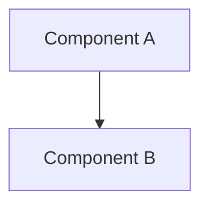
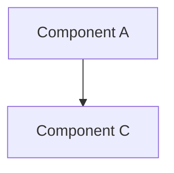

# [Change Title]

> **Scope requirement**: use this template only when model components, scientific data/tensor flow, supervision, losses, quantization, inference boundaries, or gate-relevant representation interfaces change. Operational repository changes belong in `docs/project_changelog/`.

> **Date**: YYYY-MM-DD | **Subsystem / experiment**: [owning contract ID] | **Git**: `<start_commit>..<end_commit>`
> **Status**: [Planned / In Progress / Merged]
> **Links**: [Experiment contract map](../EXPERIMENT_PLAN.md#reading-guide) | [Current runtime architecture](../ARCHITECTURE.md)

## Motivation

<!-- 1-2 sentences: why this change happened. What was the problem or design decision that drove it. -->

## Architecture Delta

### Before

<!-- Mermaid diagram of the architecture BEFORE this change -->



### After

<!-- Mermaid diagram of the architecture AFTER this change -->



## Component Changes

| File | Change | Description |
|------|--------|-------------|
| `path/to/file.py` | Added / Modified / Removed | What changed and why |

## Data Flow Changes

<!-- Describe what paths in the forward/data pipeline changed. Reference the Mermaid diagrams above for visual context. -->

## Configuration Changes

<!-- Show the config diff or describe new/removed config keys -->

```yaml
# Before (if applicable)
# old_key: old_value

# After
# new_key: new_value
```

## Loss Function Changes

<!-- If loss terms were added, removed, or reweighted -->

| Loss Term | Change | Weight |
|-----------|--------|--------|

## Linked Artifacts

- **Config**: exact versioned configuration path from the owning experiment entry
- **Experiment**: `experiments/runs/physiology_semantic_tokenizer/<suite>/<run_name>/`
- **Evidence**: owning run summary and declared endpoints
- **Related changelog entries**: `YYYY-MM-DD_title.md`

## Contract and Claim Impact

<!-- Name the existing protocol and affected contract or endpoint. Include a gate only when the owning protocol defines it. -->

| Contract / endpoint | Impact | Evidence or validation |
|------|--------|-------|
| [Affected contract or endpoint] | [Expected change or unchanged invariant] | [Owning source] |

## Design Decisions

<!-- Key choices made during implementation and why. Especially useful for non-obvious decisions. -->

## Rollback Considerations

<!-- If this change needed to be reverted, what else would need to change? -->
