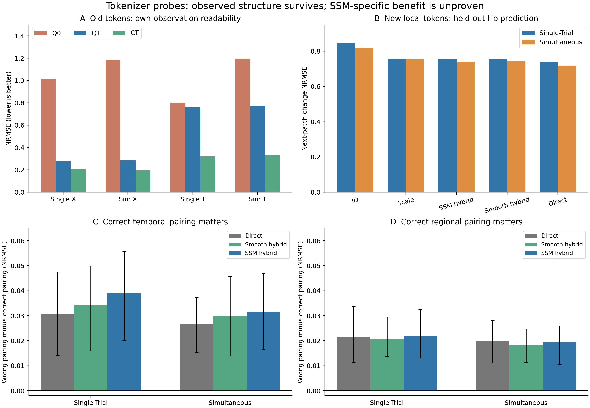
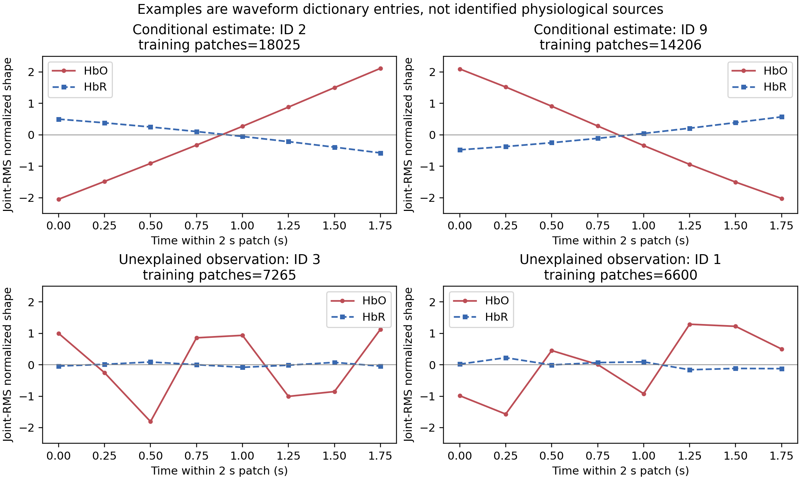

# 当前 SSM 约束下的 tokenizer 快速探针

2026-10-25；公开开发复分析，三组共 21 个完整条件／种子任务，另有三个吞吐先导。

## 结论与建议

建议采用**形状 ID＋连续均值／幅度＋时间／区域身份**的局部混合表示。它能保留一部分下一时段 Hb 变化及正确区域配对的信息。当前证据支持的是具有观测语义的表示；SSM 可以提供条件解释坐标，但未稳定优于相同架构的平滑目标。纯 ID 会损失重要信息，压缩后的预测仍弱于直接观测。没有获得唯一生理来源、个体参数恢复或因果耦合证据。

QT 比 Q0 更容易读出 X，但 QT 的 T 读出明显弱于连续 CT。新候选通过连续尺度补回部分信息；破坏时间或区域配对后预测变差，但直接观测和平滑候选也存在同类效应，因此这不是 SSM 或 token 独有机制。

图中 A 是旧 token 对自身可见观测的读出，B 是新局部表示对下一 patch 变化的预测，两者不能横向比较误差大小。C/D 柱高是“错配误差−真实配对误差”，正值表示正确配对更好；误差棒为按被试整簇重采样的未校正 95% 描述区间。每库六名测试被试，三种子先在被试内平均。

## 数据、分母与信息边界

只读取已完成公开父运行 `20261011_v1` 的缓存、身份与冻结出口，没有重读原始数据、受保护比较 split 或拟合新的 SSM。原始资料、近似 MBLL／发布 Hb 语义及统一读取路径已按数据合同核查。Single-Trial 使用相对 Hb 坐标；Simultaneous 使用发布 Hb 经父运行训练尺度变换。跨库不把这些量当统一绝对生理浓度。

父运行计划 5,008 个原生 trial，保留 4,984；每 trial 三个区域，共 14,952 个区域窗。训练／验证／测试为 32/11/12 名被试，分别有 2912/997/1075 个保留 trial。24 个父失败继续保留：Single-Trial 训练1个，Simultaneous训练4个、验证11个、测试8个。本轮结果仅对应共同成功子集，不能恢复原父实验的全分母主张。

三个 ROI 是前额、左／右运动区域的既有通道锚点，不是独立被试，也不是已分离脑源。旧关系分类只用 MI 与 n-back，共2,153个trial；新 Hb 预测使用全部4,984个保留trial，不以任务标签训练编码器。最后配对对照的4,984个trial全部有合格供体，未新增排除。

旧 QT/Q0/CT token 是20秒双向上下文中的十个2秒位置。旧邻域读出含下一token，仅是离线描述。新候选每次仅看当前2秒的8个250ms样本；Hb输入不跨bin，参考仅取此前 `[-30,-25]s`。测试未来Hb只用于评分。EEG采用父运行低维功率代理，不是原生高频电压；因上游滤波时间支持未另行核验，本轮没有做新 EEG 未来预测。

## 当前 SSM 实际提供的约束

本轮保留父teacher的六状态顺序 `(r,s,f,v,p,q)`：共享驱动、血管信号、相对流量、相对血容量、总Hb状态及脱氧Hb状态。固定参考参数包括 τ=2 s、κ=0.64 s⁻¹、α=0.32、E0=0.32；teacher使用90秒联合上下文及连续状态传播，学生在推断时没有这些特权输入。这里的设定值不能因为输出稳定就被称为已识别的个体参数。

在规范模型坐标，EEG特征由共享驱动读出，HbO=P0(p−1)−Q0(q−1)，HbR=Q0(q−1)，P0=1、Q0=0.35；随后仍须经过父观测算子、参考和训练尺度。物理域要求相对流量／体积／Hb状态为正且总Hb容纳脱氧Hb。当前方程还使 δ=p−v 满足无源衰减 `dδ/dt=−v^(1/α−1)δ/τ`。这限制了总Hb与体积之间的持续独立方向，是模型假设，不是数据证明。近期衰减／相容性诊断也未赋予其生理teacher资格。

因此可用约束是：明确的观测映射、时间响应族、连续传播和物理可行域；不能从中直接得到唯一神经源、真实血容量或可靠个体τ。本轮只蒸馏这些约束下的**条件输出波形**，保留全部未解释观测。新tokenizer的代码分支名 `r` 表示观测剩余，与SSM状态中的驱动 `r` 不同；该剩余还包含局部学生对联合teacher的预测误差，不能等同于原求解器额外项或生理噪声。

具体模型合同见[保留的六状态与参数定义](../../../../../experiments/configs/physiology_semantic_tokenizer/shared_driver_physiology_semantics_v1.yaml)，teacher读取方式见[父tokenizer合同](../../../../../experiments/configs/physiology_semantic_tokenizer/functional_tokenizer_v1.yaml)。本轮没有改变动力学或给它补写独立生理真值。

## 第一组：旧 token 保留什么

Q0是无teacher目标的硬量化臂，QT是有SSM条件目标的硬量化臂，CT是相应连续参照。使用严格ID＋冻结码本读QT/Q0，不读取其连续出口。目标为2秒内观测均值，X=0.35 HbO−0.65 HbR，T=HbO+HbR；X是指定线性观测对比，T是相对总Hb，两者都不是独立校准的神经活动或真实血容量。NRMSE按各目标训练SD归一，越低越好。

| 数据集 | 目标 | Q0 | QT | CT |
| --- | --- | ---: | ---: | ---: |
| Single-Trial | EEG | 1.0344 | 0.8093 | 0.7962 |
| Single-Trial | X | 1.0190 | 0.2782 | 0.2092 |
| Single-Trial | T | 0.8020 | 0.7594 | 0.3215 |
| Simultaneous | EEG | 0.8737 | 0.7156 | 0.6961 |
| Simultaneous | X | 1.1852 | 0.2851 | 0.1956 |
| Simultaneous | T | 1.1973 | 0.7761 | 0.3345 |

QT保留X的改善跨库一致，但T明显弱于连续CT；这说明不能强制所有有效信息通过同一个硬语义瓶颈。它本身尚不能断定损失专门来自幅度，第二组对此作了拆分。

关系分类在相同32维训练PCA预算下比较区域边际、时间特征和区域同步／滞后乘积；每个方案独立拟合PCA，不是严格嵌套条件信息检验。QT双模态平衡准确率如下。

| 任务 | 边际 | 加时间 | 再加区域 |
| --- | ---: | ---: | ---: |
| MI | 51.85% | 48.66% | 48.66% |
| n-back | 41.03% | 40.05% | 37.71% |

旧token没有稳定的任务关系收益，也没有一致超过关系重组对照。分类收益不是本轮生理解释的证据来源。

## 第二组：实际训练的新候选

每模态独立、各ROI共享一个小ridge编码器，把当前观测patch u 映射为同patch的条件波形 c；观测剩余 r=u−c。SSM臂拟合父physical输出，平滑臂拟合父运行训练集确定的平滑目标，其余容量、预算及划分相同。编码器训练和码本拟合只用训练被试，验证被试选择ridge正则；推断不读取teacher。编码器选择是被试等权、被试内部patch等权，最终预测评分再按记录等权。

对每支 s：保留每通道均值 μ，计算跨时间和通道共同的正 RMS 幅度 a；将 (s−μ)/max(a,10⁻⁶) 的形状用16项码本离散化。共同幅度保留两色团相对标度；近乎平坦的patch显式使用零形状。hybrid通过固定字典执行 μ+a×shape_center，而不是让线性读出临时学习乘法。c只称模型条件估计，r只称未解释观测，不能称生理源和噪声。

以上是SSM seed17在训练集使用最多的两个条件支ID与两个剩余支ID。红实线圆点为HbO、蓝虚线方点为HbR；纵轴为共同RMS归一后的字典形状，均值和幅度另存，统一刻度。ID2/ID9可描述为相反的HbO/HbR斜坡形态，不能命名为已识别的神经激活／抑制。剩余支保留较快波动，来源仍未定。不同种子的ID编号不具有天然对应关系。

预测目标是下一2秒的X/T均值减当前均值，当前位置固定为1–8（从0计），因此比较有共同的八个评分位置；不跨窗口拼接。每目标ROI分别拟合读出，自己的当前／前一patch和其他ROI的对应patch均在可见范围。保持不变预测对应“变化=0”。直接观测基线使用完全相同时间及区域支持的原Hb patch，不能被省略。

三区域前／当前输入下的联合X/T NRMSE：

| 数据集 | 仅ID | 仅尺度 | SSM hybrid | 平滑 hybrid | 连续两支 | 直接观测 | 保持不变 |
| --- | ---: | ---: | ---: | ---: | ---: | ---: | ---: |
| Single-Trial | 0.84835 | 0.75836 | 0.75402 | 0.75334 | 0.73910 | 0.73659 | 0.90072 |
| Simultaneous | 0.81787 | 0.75549 | 0.74047 | 0.74368 | 0.71574 | 0.71806 | 0.95390 |

主要配对差如下；正值表示表中所列候选更好，区间为未校正描述区间。

| 数据集 | ID−hybrid | 尺度−hybrid | 平滑−SSM hybrid | 直接观测−hybrid |
| --- | --- | --- | --- | --- |
| Single-Trial | 0.09433 [0.05651, 0.13919] | 0.00434 [-0.00528, 0.01388] | -0.00068 [-0.00327, 0.00224] | -0.01742 [-0.02540, -0.00956] |
| Simultaneous | 0.07740 [0.05248, 0.11292] | 0.01502 [0.00809, 0.02285] | 0.00321 [-0.00115, 0.00853] | -0.02241 [-0.02748, -0.01762] |

本候选中，保留连续尺度明显优于仅保留归一化形状ID；形状ID在尺度之外的增量在Simultaneous较明确，Single-Trial仍不确定。SSM与平滑差异均不明确，且hybrid弱于直接观测。连续两支可代数还原输入，其与直接观测的微小差别来自坐标及ridge正则，不代表新增信息。SSM对自身条件目标的蒸馏更好，也不能代替实际预测效用。

Hb每2秒每ROI：两个16类ID名义8bit，六个float32尺度192bit，合计200bit；当前int16 ID序列化后合计224bit。原观测是16个float32，即512bit，因此不计固定码本／编码器／身份开销的压缩分别约2.56倍和2.29倍。尺度占名义码率96%，不能把此结果说成纯离散编码成功；连续两支的1024bit不是原始数据分母。

## 第三组：正确配对是否重要

冻结新候选，不重训编码器或teacher。时间对照保持当前patch真实，仅把前一patch换成同相位供体；空间对照保持目标ROI的前／当前真实，另外两个ROI共同来自同一个供体trial的完整序列。供体限于同数据集、被试、记录、条件和split的不同原生trial，排除自身与区域副本；每个读出分别重拟合，所有表示和种子用相同供体图。条件标签只用于这一诊断匹配，不进入回归特征。

下表为错配NRMSE减真实配对NRMSE；正值表示正确样本关系有用。

| 数据集 | 表示 | 时间配对 | 区域配对 |
| --- | --- | --- | --- |
| Single-Trial | 直接观测 | 0.03076 [0.01410, 0.04744] | 0.02145 [0.01123, 0.03372] |
| Single-Trial | 平滑 hybrid | 0.03434 [0.01604, 0.04987] | 0.02068 [0.01360, 0.02951] |
| Single-Trial | SSM hybrid | 0.03909 [0.02002, 0.05576] | 0.02186 [0.01309, 0.03251] |
| Simultaneous | 直接观测 | 0.02674 [0.01529, 0.03738] | 0.01998 [0.01115, 0.02818] |
| Simultaneous | 平滑 hybrid | 0.02989 [0.01389, 0.04582] | 0.01838 [0.01126, 0.02464] |
| Simultaneous | SSM hybrid | 0.03167 [0.01646, 0.04701] | 0.01931 [0.01059, 0.02599] |

正确时间和区域配对均有预测效用，说明不是仅增加输入维度或保留条件模板即可解释全部收益。时间收益主要来自X；T的时间配对区间两库均跨零。区域配对对X/T的四项区间均为正。直接观测和平滑也存在这些收益，因此本轮证明的是压缩表示保留了观测关系，并未证明SSM独有机制、token特有几何或因果耦合。供体操作是条件匹配扰动，不能当作精确随机化显著性检验。

## 对 tokenizer 和科学叙事的落实

1. 输入端保持模态独立，显式保存时间、ROI、单位／训练尺度及可见支持。Hb局部patch可做下一段读出；旧双向token保留离线标签。
2. 以可解码的波形形状为ID语义，均值和幅度独立输出。保留ID-only、scale-only、hybrid及连续参考，禁止用连续旁路成绩宣称纯ID能力。
3. 条件预测与未解释观测分开保留。SSM做可替换的辅助目标或解释坐标，平滑目标继续作同容量基线；当前没有证据要求SSM是必要组件。
4. 时序／区域关系用未见被试上的后续观测预测和配对扰动评价，不能靠转移热图、聚类外观或任务分类单独支撑。
5. 模型参数／成分归属另行判断。父运行QT隐藏Hb补全仍差于仅Hb上下文（两库NRMSE分别增加0.01229、0.01583）；本轮区域预测结果不反向证明跨模态收益。既有合成中QT对仅观测off-D扰动的响应约为真实τ增加1秒响应的2.5–2.8倍，说明语义并非参数特异。构造alias只是相同观测的归属反例，不是两条合法SSM生理轨迹的证明。

本轮可使用的叙事是：**局部形状字典与连续尺度组成的表示，能够保留一部分血红蛋白观测的短时变化与跨区域对应关系；其生理解释限于明确观测坐标和模型条件假设。** 后续若需要更强生理命名，应检验独立生理锚点、跨记录／新被试复现及参数可识别性。本轮没有启动这些扩展或受保护评价。

## 指标、复核与证据入口

预测每个坐标先以对应ROI训练集变化SD归一，时间位置及ROI均方后，trial在记录内平均、记录在被试内平均，再开方得到每被试NRMSE；联合X/T先平均两坐标的标准化均方。三个优化种子先在被试内平均，然后被试等权。表中跨库分别报告，不把patch、ROI、trial或种子视为独立被试。bootstrap为2000次被试有放回重采样，种子20261025，区间未作多重比较校正；只有每库6人，不是新的确认性证据。

21/21完整任务成功，无新增失败，父24失败保留。135项针对性测试通过；默认收集2068项，按既有配置排除11项。项目状态校验、生成视图一致性及git diff --check均通过，见[软件交付核验](software_validation.json)。直接／保持不变基线跨模型、种子一致；最后组864条真实配对分数与上一组对应分数逐值一致。抽验跨训练／验证／测试的15个窗口，从冻结模型重新编码，ID、均值、幅度和连续波形逐值复现。三个派生分析的均值／配对差经独立重算，后两组全部bootstrap区间逐值复现。

保留的首版shape summary有一项输出字段限制：648条persistence行的顶层MSE/NRMSE正确，但其嵌套region_scores的MSE/NRMSE仍是direct值；正确ROI基线值存于嵌套persistence_MSE/persistence_NRMSE。所有本报告统计只使用正确顶层值，结论不受影响。旧产物保持原样；后续producer已修正并通过回归测试，详见verification。

- [旧父实验摘要](../20261011_v1/summary.json)；[条件读出与隐藏Hb对照](../20261011_v1/readout_and_coupling_contrasts.json)。
- [冻结关系逐被试结果](../20261025_relation_v1/summary.json)；[派生配对分析](../20261025_relation_v1/analysis.json)。
- [新候选逐被试结果](summary.json)；[派生配对分析](analysis.json)；[独立复核](verification.json)。
- [最后配对对照逐被试结果](../20261025_shape_relations_v1/summary.json)；[派生配对分析](../20261025_shape_relations_v1/analysis.json)；[配对复核](../20261025_shape_relations_v1/verification.json)。
- 每个run的 resolved_config.json、source_snapshot.tar.gz、launch.json、resources.json 和 tasks/ 保存执行身份；新候选 models/ 保存可重载数值模型与分离出口。三个先导和完整运行均由user systemd监督，linger已核验；没有使用GPU。

本报告是上述数值证据的通信摘要；项目当前状态只由research_state/registry.json及其生成视图持有。
