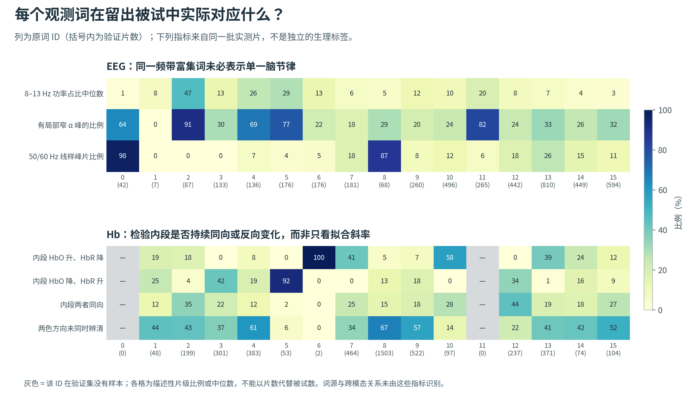
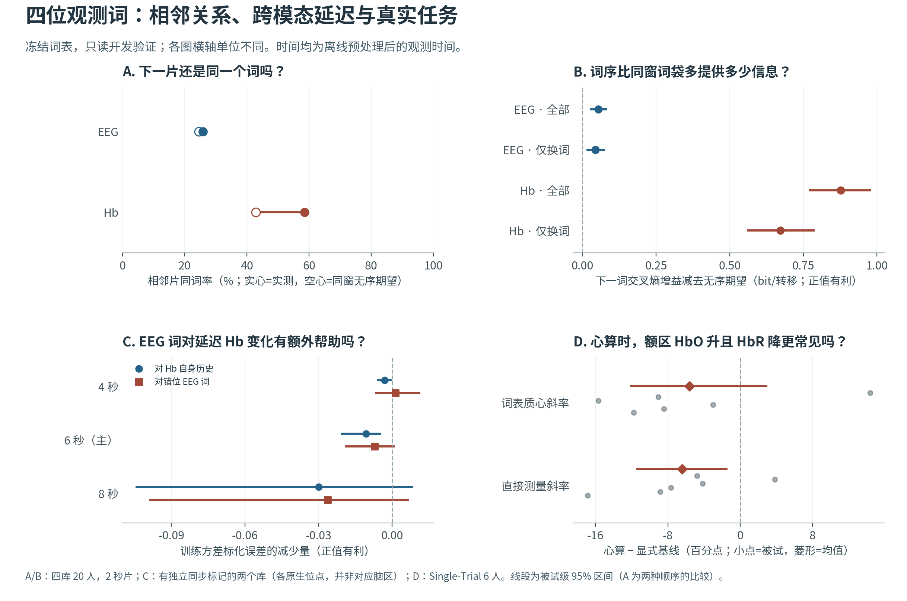

# 能用这些 token 解释什么？——冻结词表的开发实验

EEG 指脑电；Hb 指近红外记录的氧合血红蛋白（HbO）与脱氧血红蛋白（HbR）。一个词描述一个位点的 2 秒片段，同号的 EEG 词和 Hb 词并非同一个词。

**可以把词用于标记可见波形，把 Hb 词序用作慢变化的先验；不宜把词号命名为神经状态，或把 EEG→Hb 的连边解释为神经血管耦合。** 最有用的后续输入是“各词在训练中对应哪些连续属性、它出现在哪里、相邻词通常怎样变化”，而不是把 32 个词当成 32 个独立生理来源。

沿用先前发布的两套 4-bit 词表，**不重训 tokenizer、不用波形细节码**。四库 60 人训练读出器或定义词义、20 名未参与拟合的开发被试验证；完整 EEG/Hb 两秒片分别为 4,322/4,358。复现了原面板所有训练/验证 ID 的出现次数。没有打开原始信号、teacher 或测试集；这不是新的独立人群。[运行记录](summary.json) · [时钟与预处理边界](clock_basis.md)

## 1　单个词：能解释频谱或双色团形态，但说不出来源

| 训练阶段确定的词 | 验证实际看到了什么 | 可以怎么用／不能怎么说 |
|---|---|---|
| **EEG 2：α 频带富集** | 四库 8 人、87 片；8–13 Hz 功率占比的逐片中位数 46.7%。79/87 片有局部窄峰，命中峰频中位数 10.0 Hz。约 55% 的片来自同一人。 | 可检索“α 丰富、往往有窄峰”的时段。按被试、位点、α 占比和幅值匹配后，仅 6 个目标片有对照，无人达预定覆盖线。**不能判定词号在已知带功率之外仍含独立峰信息**，也不能当清醒度、闭眼或枕叶来源标签。 |
| **EEG 0：高频富集** | 42 片中 41 片呈 **50 Hz 线样峰**，仅 1 片呈扩散状高频；3 名被试中一人贡献了 40 片。 | 在这一面板上更适合当作工频污染的复核提示，而不是 γ 活动。不是伪迹真值，不能见此 ID 就自动剔除。 |
| **Hb 6、12：训练中分别偏反向和同向** | 词 6 的 2 个验证片均为内部 HbO 升、HbR 降，但只有 1 库 2 人，与词 12 没有同人同位点且两色团水平可比的匹配。词 12 的 237 片中，104 片两者同降，81 片反向，52 片方向未同时辨清。 | 可描述**相对水平和斜率倾向**，不能把词 6 称为“激活”，也不能把词 12 当作固定的双色团同向状态。词 0、11 在 Hb 验证集无样本；不为它们作验证命名。 |

**还能直接检索哪种 Hb 波形？** 看完整词表时，词 5 是一个有用的例子：四库 10 人的 53 片中，49 片的内部确实是 **HbO 降、HbR 升**；反过来，最常见的词 8 有 1,503 片，1,003 片无法同时确认两色团方向。因此“词 5 常见反向趋势”可作搜索条件，“词 8 表示静息”则没有依据。词 5 是查看全表后的描述，不代替上表中预选的词 6，也不说明变化发生的原因。

这里的 EEG 峰不是简单地重新读一次分词特征：两秒 Hann 谱先用两侧频率拟合局部对数背景，要求带内局部峰高出背景至少 6 dB、两侧突出度至少 3 dB。Hb 另看两色团内部三个时间段的中位数是否连续同向移动，不让首尾两点决定符号。这些仍是同一观测的不同读法，不是独立测得的生理源。[逐词字典（32 行）](word_lexicon.csv) · [支持数、匹配失败与逐被试诊断](phenotypes.json)

**哪些信息必然丢失？** 把 8.5 Hz 正弦反相，或改为 12 Hz，冻结 EEG 都输出词 2。保留两色团均值和斜率，把去趋势后的相关从 +1 变成 −1，冻结 Hb 都输出词 8。这两个[精确合成反例](collisions.json)不说明它们在被试中多常见，但已足以否定“一个词唯一决定详细频率、相位或残差耦合”。

## 2　词和词：Hb 有可复用的短时转移，EEG 则较弱

训练时只看过去词，估计同库同位点的下一词分布。在验证中比较真实次序与同一位点同一 30 秒窗内的乱序期望：保留**每个无缺口连续段的每个词出现次数**，不跨段、不作循环连接。表中“额外信息”是：真实次序比只用位置出现率少用多少 bit 来描述下一词，再减去乱序后的同一收益。正数表示顺序有用，不是压缩器的实际码率。

| 验证指标（库与被试等权） | EEG | Hb |
|---|---:|---:|
| 实际同词率／同窗乱序期望 | 25.8% / 24.6% | **58.5% / 42.9%** |
| 全部相邻对的额外信息，bit/转移［95% 区间］ | 0.054［0.030, 0.081］ | **0.877［0.771, 0.977］** |
| 已知换词后，预测换成哪个词的额外信息 | 0.044［0.017, 0.073］ | **0.672［0.562, 0.785］** |

验证有 EEG 4,024、Hb 4,060 个真实相邻对，区间按库内整名被试重采样，**不是用四千个片估区间**。EEG 自重复率超出乱序的区间跨零；同 K 的盲波形词也有明确次序信息（全部转移的额外信息 EEG/Hb 0.245/0.831 bit）。所以不能把“可预测”归功于生理命名本身。

**一个能回到波形核对的例子：Hb 7→13。** 这是在训练中选出的第一条非自转移边，在验证中出现 64 次，同窗词数不变的乱序期望为 37.6 次；覆盖四库 16 人。按层次等权，它占全部相邻对的 1.60%，乱序为 0.90%，差 **+0.70 个百分点［+0.34, +1.16］**。验证中，这两个词的 HbO 水平中位数由 −0.39 到 +1.04，HbO 斜率中位数均为正（+0.25、+0.19 训练尺度/秒），与**同一条缓慢上升曲线穿过两个水平区间**相容；这些中位数是各词的总体描述，不是每一次转移的实测轨迹。另一个训练候选 13→12 的区间跨零。没有证据把某条边命名为“脑区激活传播”。[全部候选边（含失败）](dynamics_edges.csv) · [同率盲词/无序对照](dynamics_scores.csv)

## 3　跨模态：没有检出可复用的 EEG→Hb 延迟词关系

主分析用有双设备标记的 Single-Trial 和 Simultaneous 两库。基线看本位 Hb 当前及过去两片的词、水平、斜率和幅值，另控制库、位点、窗内相位和 EEG 幅值。只在此基础上加入当下 EEG 词，预测 **6 秒后**（两片起点相差 6 秒）的 HbO/HbR 水平增量；所有读出器只在训练人中拟合。对照把 EEG 词换成同窗严格过去的词，或换成同 K 的盲波形词。两 EEG 位点合用时是 8 bit，不因有两个 Hb 输出重复计费。

- 11 人、93 个验证窗、792 个唯一起点、1,558 个 Hb 位点目标。两色团平均的训练方差标化误差由 **0.9096 升至 0.9202**；增益定义为基线误差减新误差，故为 **−0.0107［−0.0205, −0.0049］**。11 人中没有一人改善。真词相对错位词或盲词的区间也未越过正向门槛。
- 直接预测 **未来 Hb 词**也不改善：Brier 误差由 0.7863 升到 0.7918。四库敏感性分析的 6 秒连续目标增益为 −0.0060［−0.0108, −0.0023］；4/8 秒也没有出现可靠反转。跨库宏区间按库、再按被试嵌套重采样，主要分析只有两个库。
- 并非代码不能检出延迟：[合成 6 秒注入](synthetic_delay.json)时，同一读出增益为 +0.491，独立空模型为 −0.027。这个强注入不证明有能力排除微弱的真实效应。所选 EEG/Hb 位点不保证同位，Hb 又经历整记录双向滤波（0.01–0.2 Hz）；结果既不是严格实时预测，也**不是“没有神经血管耦合”**。[主要库的配对结果](coupling_primary_summary.csv) · [四库敏感性](coupling_four_summary.csv)

## 4　外部任务：有可追踪的频带线索，没有通用“激活词”

Single-Trial 按两条设备时钟对齐原记录的心算（MA）和显式基线（BL），比较标记后 +2 至 +10 秒。131 个 MA、133 个 BL 试次，共 264/360；6 人、18 个同时含两类的 session。先在同一人同一 session 内做 MA−BL，再等权汇总；主终点是训练质心满足“HbO 斜率正且 HbR 斜率负”的 6 个词的额区占有率。

- **预设的增加没有出现。** 心算 23.85%、基线 29.45%，差 **−5.60 个百分点［−12.07, +2.87］**；5/6 人下降，双侧被试符号翻转参考 p=0.25（非试次随机化检验）。原 X 直接算同时满足两种斜率的比例也低 6.41 个百分点［−11.40, −1.52］。这是对“这段时间任务中上升/下降得更频繁”的检验，不是对 HbO 水平升高或完整血流响应的否定。
- **更值得复核的是按词的训练质心读出频谱，而非数“富集词”出现次数。** 心算时，后顶 α 的 ID 质心读出比基线低 **1.22** 个百分点［−2.23, −0.20］，原 X 低 **2.14**；额区 θ 的 ID 质心读出高 **1.52** 个百分点［+0.08, +3.23］，原 X 高 **2.25**。但相应二值富集词的占有率差，两者区间均跨零。这是六人、多项次要读出中方向相合的线索，不是新的独立确认或心算分类优势。[事件合同、分母、全部阶段与逐被试结果](events.json)

## 后续模块如何使用

保留两路各自的**原生位点、时间、训练质心和不确定度**。可以先用 Hb 同模态转移概率做时序基线；做机制发现时，要求新模块超越 Hb 自身历史、同窗词袋和同 K 盲词。把 EEG 词 2 用作窄峰复核的入口、词 0 用作查看线频干扰的提示，不硬编码为来源。若以后要主张神经血管关系，下一步应先固定可核对的同位/邻近 ROI、使用不偷看未来的预处理和刺激/系统性生理对照，再在新的被试上验证；**不建议用当前 EEG→Hb 边作为训练真值**。

[冻结合同](../../../../../experiments/configs/physiology_semantic_tokenizer/observation_relations_v1.yaml) · [50 项本轮合成与合同测试](synthetic_tests.log) · [逐人复算 274 项比较](verification.json)。主表未用保护或测试数据；区间均以冻结模型和已观察到的开发面板为条件，探索性多重比较未作确认性校正。
