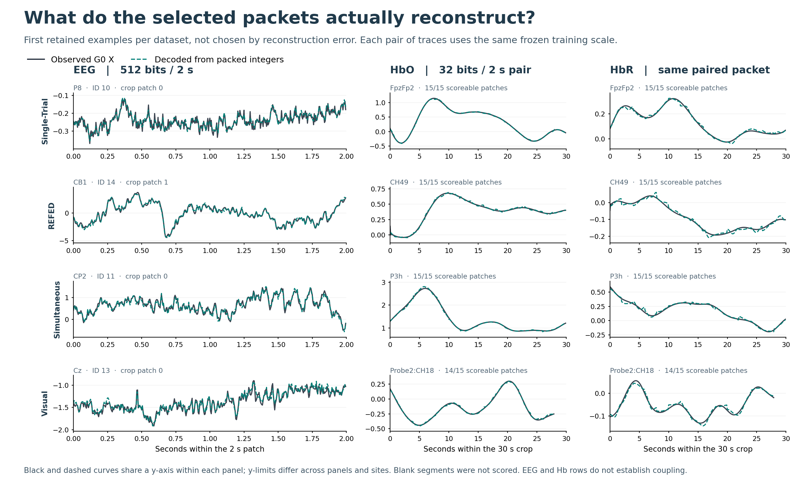
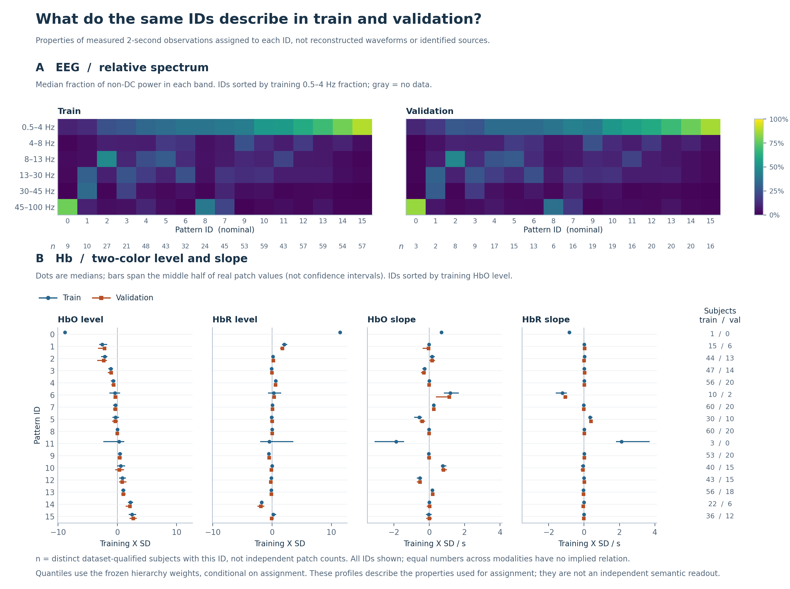

# 两秒观测 tokenizer：开发结果简报（2026-11-20）

**结论：冻结 4 bit 观测词，另传整数细节来还原波形。** 每个 EEG 电极按六个频带的相对功率分成 16 类；每个 Hb 位点按 HbO/HbR 的水平与斜率联合分成 16 类。下游可以只读词；需要相位或幅值时才解码细节。两种模态都达到开发时设定的波形标准，但没有证据把这些词命名为生理来源或声称心算识别更好。

### 重建：改进是否来自更多位数？

四个公开库，60 人训练、20 人开发验证。评分只用预处理后的观测 X：EEG 为 4,322 个完整两秒片，Hb 为 4,358 个；先按训练方差归一化平方误差，再按位置、窗口、记录、被试、库逐层等权。下表每项均为每两秒、每个原生位置的**实际总位数**，包括模式词，不传浮点旁路。flat 对照不发送模式词，把全部位数用于变换系数。

| 冻结模型 | 总位数 | X NMSE ↓ | 去均值波形余弦 ↑ | 同位率 flat 的 X NMSE ↓ |
|---|---:|---:|---:|---:|
| EEG：模式词＋量化均值、振幅与形状 | 512 | **0.03327** | **0.964** | 0.06343 |
| Hb：模式词＋按词分配位数的双色团细节 | 32 | **0.00412** | **0.873** | 0.00580 |

- **EEG：同位率的改进明确。** 相对 flat 的 NMSE 差为 −0.03016（库内配对被试自举 95% 区间 [−0.04080, −0.01614]；19/20 人更低）。仍用 512 bit，显式量化均值与振幅后，Single-Trial 的 30–45 Hz 功率偏差由 +13.87 降到 −0.78 dB。四库宏值为 −1.15 dB，带内复谱余弦 0.809。
- **Hb 与低位率：保留反例。** Hb 相对同率 flat 的区间跨零（[−0.00416, +0.00147]）。若总预算限于 14 bit，在相同 X 上，旧双 K128 的 EEG/Hb NMSE 为 0.2511/0.0141，低于新自适应方案的 0.3791/0.0384；旧模型使用 30 秒上下文，新模型只看 2 秒。



### 模式：能读出什么，不能推出什么？

在库、位置和幅值等背景变量之上加入模式 ID，当前片 EEG 自相关及 Hb 首末变化的读出误差分别下降 **60.1% / 53.6%**。例如 EEG 词 2 的 8–13 Hz 功率占比，训练/验证中位数为 47.6%/46.4%。这些属性与分词特征在数学上相关；16 个 Hb 词中还有 2 个在验证集完全未出现。



**独立标签没有证实优势。** Single-Trial 心算对显式基线，验证保留 6 人、264/360 次试验；融合模式词的被试等权平衡准确率为 **52.4%**，同 K 盲波形词为 **55.1%**（配对差 −2.7 个百分点，95% 区间 [−8.1, +2.4]）。这是重复使用开发面板选档后的离线基线，未打开测试集；既有 Hb 个体校准也不等于新被试零校准。

### 复核与使用

- [五页中文报告](20261120_baseline_review_v1/observation_baseline_review.pdf) · [机器可读决策](20261120_release_v1/decision.json) · [冻结模型、词典、训练尺度与示例](20261120_release_v1/observation_baseline.zip)。包中不含原始被试信号。
- 三步对照：[原始分词与码率扫描](20261120_development_v3/reconstruction.csv) → [固定词表、更改细节位分配](20261120_allocation_v1/allocation.csv) → [同位率 EEG 增益/形状消融](20261120_gain_v1/gain_shape.csv)。另见 [模式支持与分位数](20261120_development_v3/atlas.csv)、[心算配对区间](20261120_development_v3/paired_task_contrasts_v1.json) 和 [四库整数包回放](20261120_release_v1/heldout_replay.json)。
- [运行入口与测试](../../../README.md#entrypoint-config-and-test-map)记录三阶段的合同与次序。运行完整实测需恢复同版本 G0/事件缓存及冻结对照检查点；只验证发布包不需要这些数据。在仓库根目录用已有 Python 环境执行：

```sh
pkg=experiments/runs/physiology_semantic_tokenizer/observation_factorization/20261120_release_v1/observation_baseline.zip
out=$(mktemp -d)
unzip -q "$pkg" -d "$out"
.venv/bin/python "$out/observation_baseline/demo.py"
```
